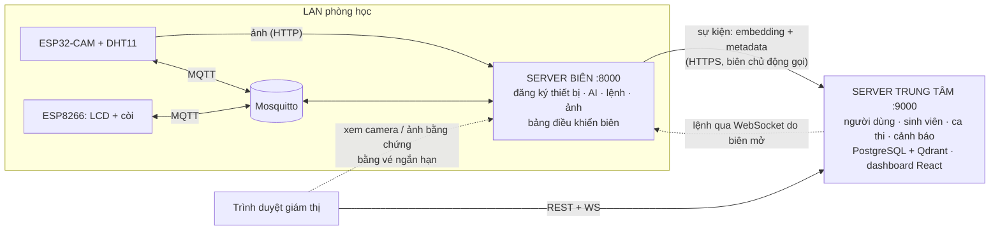

# Hệ thống phòng học thông minh — server trung tâm + server biên

Điểm danh / kiểm tra vào phòng thi bằng khuôn mặt, giám sát gian lận, theo dõi nhiệt độ – độ ẩm, điều khiển còi và LCD.
Bản này tách hệ thống thành **một server trung tâm** và **một (hoặc nhiều) server biên** đặt trong mạng của phòng học.



| | Server trung tâm (`backend/central/`) | Server biên (`backend/edge/`) |
|---|---|---|
| Nhiệm vụ | Người dùng, phân quyền, phòng/lớp/sinh viên, kho vector khuôn mặt, ca thi, cảnh báo, audit, lịch sử telemetry, dashboard | Broker MQTT, **thiết bị tự đăng ký**, vòng đời + khoá thiết bị, nhận ảnh, **AI**, lệnh có ACK, LCD, bảng điều khiển thiết bị |
| Lưu trữ | PostgreSQL + Qdrant | SQLite + thư mục ảnh (tự xoá sau 7 ngày) |
| Ảnh | **Không nhận, không lưu** | Chỉ tồn tại ở đây |
| Cổng | 9000 | 8000 (+ MQTT 1883) |

Hai nguyên tắc của thiết kế:

1. **Thiết bị không cần nạp lại firmware, không ai chép khoá bằng tay.** Firmware nạp một lần, không chứa Wi-Fi/địa chỉ/khoá.
   Thiết bị tự tìm server biên (mDNS), tự báo danh; quản trị viên bấm *Đăng ký* → *Gán phòng* trên bảng điều khiển biên;
   thiết bị tự nhận khoá MQTT. Đổi Wi-Fi, đổi phòng, cấp lại khoá, đổi IP server đều tự phục hồi.
2. **Ảnh thật không rời server biên.** Biên chỉ gửi lên trung tâm embedding 512 chiều và metadata (mã SV, điểm, số tham chiếu ảnh).
   Người dùng xem camera / ảnh bằng chứng trực tiếp từ biên bằng "vé" ngắn hạn do trung tâm ký sau khi kiểm tra quyền.

## Cấu trúc thư mục

```
backend/
  central/app/      FastAPI trung tâm: router, service, model, cấu hình
  edge/app/         FastAPI biên: API thiết bị, service MQTT, worker AI
  edge/models/      Trọng số YOLO
  shared/           UTC, SQLAlchemy và vé JWT dùng chung
frontend/
  dashboard/        Dashboard React (Vite + Tailwind)
  edge-console/     Bảng điều khiển biên bằng HTML/JS thuần
database/           Migration và tài liệu CSDL
deployment/
  central/          Docker Compose PostgreSQL + Qdrant
  edge/             Docker Compose Mosquitto + Dynamic Security
firmware/           Firmware ESP32-CAM / ESP8266 tự đăng ký
hardware/           BOM, sơ đồ nối dây và ảnh prototype
tests/
  integration/      Kiểm thử đầu-cuối trung tâm + biên
  simulators/       Bộ mô phỏng thiết bị
docs/               Kiến trúc, giao thức và biên bản kiểm tra
legacy/             Mã cũ chỉ giữ để tham khảo
```

Tài liệu phân tích và thiết kế, gồm sơ đồ bối cảnh, use case, kiến trúc tổng thể và kiến trúc phân lớp, xem tại
[`docs/PHAN_TICH_THIET_KE.md`](docs/PHAN_TICH_THIET_KE.md).

## Chạy nhanh

Sao chép `.env.example` thành `.env` ở thư mục gốc và thay các giá trị mẫu trước khi chạy.

```bash
# 1) Cài thư viện Python
python -m pip install -r backend/central/requirements.txt -r backend/edge/requirements.txt

# 2) Hạ tầng (Docker Desktop đang chạy)
cd deployment/central && docker compose up -d                       # PostgreSQL :5432, Qdrant :6333
cd ../edge && python init_mqtt.py && docker compose up -d           # Mosquitto :1883

# 3) Hai server (ở thư mục gốc, mỗi lệnh 1 cửa sổ)
python -m uvicorn backend.central.app.main:app --host 0.0.0.0 --port 9000
python -m uvicorn backend.edge.app.main:app    --host 0.0.0.0 --port 8000

# 4) Worker AI tại biên
python -m backend.edge.app.workers.face_worker
python -m backend.edge.app.workers.exam_worker

# 5) Dashboard (dev)
cd frontend/dashboard && npm install && npm run dev   # http://localhost:5173
```

- Dashboard trung tâm: `admin@classroom.local` / `Admin@123` (đổi ngay).
- Bảng điều khiển biên: `http://<ip-server-biên>:8000/`, mật khẩu `edge-admin` (đặt `EDGE_ADMIN_PASSWORD`).
- Chưa có phần cứng: `python tests/simulators/sim_device.py camera` và `python tests/simulators/sim_device.py actuator`, rồi duyệt trên bảng điều khiển biên.

## Kiểm thử

```bash
python -m pytest tests -q        # 36 ca, không cần Docker / phần cứng
```

Kịch bản: thiết bị tự báo danh → duyệt → tự nhận khoá → online → telemetry + khuyến nghị LCD → mất kết nối trung tâm rồi gửi bù
→ lệnh có ACK / thử lại / timeout → mở ca thi, vector xuống biên → AI cho vào phòng + còi → nghi vấn → giám thị xác nhận
→ vé xem ảnh tại biên → đổi phòng, tạm khoá, giả mạo MAC, factory reset, thu hồi.

## Giới hạn đã biết

- Trong LAN, thiết bị ↔ server biên dùng HTTP/MQTT **không TLS** (ESP8266 thiếu bộ nhớ cho TLS — mục 16 của tài liệu thiết kế). Biên ↔ trung tâm nên đặt sau HTTPS khi triển khai thật.
- Trình duyệt muốn xem camera / ảnh bằng chứng / đăng ký khuôn mặt phải **tới được server biên** (cùng LAN hoặc VPN) — hệ quả trực tiếp của việc ảnh không đi qua trung tâm.
- Firmware đã biên dịch sạch cho cả hai board nhưng **chưa được chạy trên phần cứng thật** trong đợt làm này; luồng đăng ký đã được kiểm bằng bộ mô phỏng với Mosquitto thật.
- Server biên ↔ trung tâm xác thực bằng khoá chung cấu hình tay ở hai phía (mỗi biên một khoá).
- Mỗi sinh viên có thể đăng ký khuôn mặt ở biên nào thì ảnh cắt xem lại nằm ở biên đó; vector thì dùng chung toàn hệ thống.
