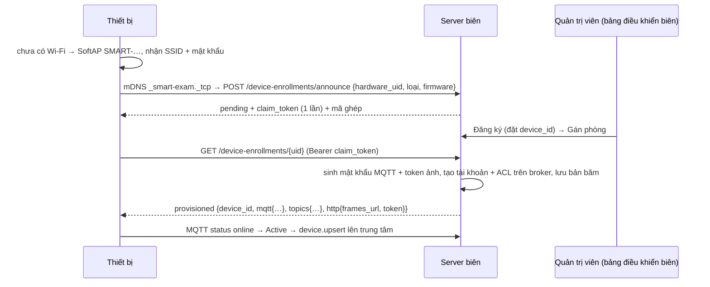

# Kiến trúc: server trung tâm + server biên

Tài liệu này bổ sung cho bản thiết kế gốc (mục 5–10 và phần "Quy trình lắp đặt"): những gì thay đổi khi tách backend
đơn khối thành hai tầng, và vì sao.

## 1. Ai giữ cái gì

| Dữ liệu / trách nhiệm | Trung tâm | Biên | Ghi chú |
|---|---|---|---|
| Người dùng, vai trò, phòng được gán, audit người dùng | ✔ | | |
| Phòng, lớp, sinh viên, đồng ý (consent) | ✔ | bản sao danh sách phòng | |
| Vector khuôn mặt (kho gốc) | ✔ Qdrant | bản sao theo ca thi | biên chỉ giữ vector của ca đang diễn ra, xoá khi ca kết thúc |
| **Ảnh** (khung hình, bằng chứng, ảnh cắt khuôn mặt) | ✘ | ✔ | trung tâm chỉ có `(edge_id, frame_ref)` |
| Ca thi, kết quả vào phòng, nghi vấn, cảnh báo, quy tắc | ✔ | bản sao giai đoạn + quyết định | trung tâm quyết định, biên thực thi |
| Lịch sử telemetry | ✔ | hàng đợi gửi (outbox) | |
| Thiết bị: yêu cầu đăng ký, khoá (bản băm), vòng đời | bản phản chiếu | ✔ | |
| Lệnh điều khiển + ACK + thử lại | chuyển tiếp | ✔ | độ trễ không phụ thuộc Internet |
| Broker MQTT, tài khoản + ACL từng thiết bị | | ✔ | |
| AI (InsightFace, YOLO) | ✘ | ✔ | trung tâm không cài thư viện AI |

## 2. Ba kênh giữa biên và trung tâm

Biên luôn là bên **chủ động kết nối**, nên chạy được sau NAT của phòng học. Xác thực: `X-Edge-Id` + `Authorization: Bearer <khoá chung>`.

| Kênh | Hướng | Dùng cho | Mã |
|---|---|---|---|
| `POST /api/v1/edge/events` | biên → trung tâm | sự kiện theo lô từ **outbox** bền vững | `backend/edge/app/services/uplink.py`, `backend/central/app/services/edge_events.py` |
| `GET /api/v1/edge/sync`, `/edge/exams/{id}/roster` | biên kéo | trạng thái mong muốn: phòng, ca thi đang diễn ra, vector danh sách dự thi | `backend/edge/app/services/exam_state.py`, `backend/central/app/services/session_service.py` |
| `WS /api/v1/edge/link` | trung tâm → biên (qua kết nối do biên mở) | hỏi–đáp: `sync`, `command`, `room_buzzer`, `commands`, `config`, `face_delete` | `backend/central/app/services/edge_link.py`, `backend/edge/app/services/ops.py` |
| `POST /api/v1/edge/faces`, `/edge/identify` | biên → trung tâm | gửi **vector** khuôn mặt mới; hỏi "vector này là SV nào?" | `backend/central/app/routers/edge.py` |

**Outbox.** Mỗi thay đổi cục bộ ghi sự kiện vào bảng `outbox` trong cùng giao dịch; luồng nền gửi theo lô, lỗi thì thử lại với
backoff 1→30 s. Trung tâm loại trùng theo `(edge_id, event_id)` nên giao "ít nhất một lần" là an toàn. Sự kiện tức thời
(`checkin.seen`, `command.updated`) có hạn dùng, quá hạn thì bỏ.

Các loại sự kiện: `device.upsert`, `device.event`, `telemetry`, `command.updated`, `checkin.admitted`, `checkin.rejected`,
`checkin.seen`, `exam.suspicion`. Không loại nào chứa ảnh.

**Sync kiểu "trạng thái mong muốn".** Trung tâm không đẩy từng thay đổi mà trả toàn bộ trạng thái hiện tại; biên so sánh và áp dụng
(bật đúng camera, tải vector khi `roster_hash` đổi, dọn ca đã kết thúc). Biên kéo mỗi 30 s và ngay khi trung tâm "nhắc" qua kênh
WebSocket → mất một lời nhắc không gây lệch trạng thái.

## 3. Thiết bị tự đăng ký

- Khoá chỉ được sinh **khi chính thiết bị tới lấy** và chỉ lưu bản băm; không hiển thị cho người, không nằm trong firmware.
- **Một quy tắc tự phục hồi** ở firmware thay cho mọi thao tác thủ công: MQTT bị từ chối / không tới được 3 lần liên tiếp →
  tìm lại server biên qua mDNS → hỏi lại bằng claim token → nhận khoá + topic mới. Nó xử lý đổi phòng, cấp lại khoá, đổi IP server.
- **Chống giả mạo MAC.** Thiết bị đã đăng ký mà báo danh không kèm claim token (factory reset, hoặc kẻ giả MAC) chỉ tạo được
  "yêu cầu ghép lại"; khoá chỉ được cấp cho token mới sau khi quản trị viên chấp nhận (đối chiếu mã ghép hiện trên thiết bị).
  Thiết bị thật không bị ảnh hưởng trong lúc đó.
- Camera điện thoại (`phone_bridge`) và bộ mô phỏng dùng đúng giao thức này (`backend/edge/app/workers/virtual_device.py`).

Vòng đời (mục 10) giữ nguyên các trạng thái; khác biệt: `Registered` = đã đăng ký nhưng chưa có khoá (chờ gán phòng hoặc chờ
thiết bị nhận khoá), `Provisioned` = đã nhận khoá, chưa kết nối MQTT.

## 4. Ảnh không rời biên

| Việc | Luồng |
|---|---|
| Nhận diện vào phòng | ảnh → biên → embedding → so với vector danh sách dự thi **tại biên** → sự kiện `{student_id, confidence, frame_ref}` |
| Người ngoài danh sách | biên gửi **embedding** lên `/edge/identify`; trung tâm trả mã SV hoặc "không khớp" |
| Nghi vấn gian lận | biên đánh dấu ảnh, lưu tại chỗ → sự kiện `{type, score, student_code, detail, frame_ref}` |
| Đăng ký khuôn mặt | trình duyệt xin vé ở trung tâm → gửi ảnh **thẳng tới biên** → biên gửi vector lên trung tâm |
| Xem camera / ảnh bằng chứng / ảnh khuôn mặt | trung tâm kiểm tra quyền + ghi audit → trả URL có **vé** → trình duyệt tải thẳng từ biên |

**Vé (ticket)** là JWT HS256 ký bằng khoá chung của đúng server biên đó, sống 5 phút, mang `scope` hẹp
(`stream:<device>`, `frame:<id>`, `faces:<student_id>`). Biên chỉ kiểm chữ ký + scope (`backend/shared/security.py`).

## 5. Quyết định thiết kế (nối tiếp ADR-01…07 của tài liệu gốc)

**ADR-08. Tách trung tâm / biên; biên chủ động kết nối.** Vòng điều khiển cục bộ (ảnh → AI → còi, telemetry → LCD) chạy tại biên
nên không phụ thuộc Internet; trung tâm tập trung nghiệp vụ và dữ liệu dài hạn. Đã cân nhắc để trung tâm gọi HTTP xuống biên:
đơn giản hơn nhưng buộc biên có địa chỉ công khai — loại. *Đánh đổi:* dữ liệu thiết bị ở trung tâm là bản phản chiếu, có thể trễ khi
biên mất kết nối (dashboard hiển thị rõ trạng thái kênh).

**ADR-09. CSDL của biên là SQLite.** Biên phải rẻ và không cần quản trị; khối lượng nhỏ (vài chục thiết bị, hàng đợi ảnh ngắn).
Hàng đợi job AI dùng cập nhật có điều kiện thay cho `FOR UPDATE SKIP LOCKED`. Mã truy vấn viết trung lập nên có thể trỏ
`EDGE_DATABASE_URL` sang PostgreSQL nếu cần. *Sửa ADR-04:* PostgreSQL + Qdrant chỉ còn ở trung tâm.

**ADR-10. Ảnh ở lại biên; chỉ embedding + metadata lên trung tâm; xem ảnh bằng vé.** Ảnh khuôn mặt là dữ liệu nhạy cảm: giảm nơi
lưu, giảm đường truyền. *Đánh đổi:* người xem phải tới được server biên (LAN/VPN); ảnh bằng chứng mất nếu máy biên hỏng trước khi
hết 7 ngày lưu. *Sửa ADR-03:* AI chạy ở server biên, không chạy ở trung tâm.

**ADR-11. Đăng ký không chạm bằng claim token + mDNS thay cho `secrets.h`.** Bỏ hẳn việc nạp lại firmware khi đổi mạng/phòng/khoá
và việc chép khoá bằng tay. Đã cân nhắc giao diện mã nguồn mở có sẵn (ThingsBoard, EMQX Dashboard, ESPHome): không cái nào hỗ trợ
quy trình báo danh → duyệt → gán phòng → cấp khoá + ACL theo phòng của hệ thống này nếu không viết thêm tích hợp lớn hơn cả một
bảng điều khiển riêng — nên tự viết `frontend/edge-console` (HTML + JS thuần, không cần Node tại biên). *Đánh đổi:* trong LAN, khoá được
trao qua HTTP không mã hoá.

**ADR-12. Bảng điều khiển biên có tài khoản cục bộ riêng.** Người lắp đặt làm việc tại chỗ, kể cả khi mất kết nối trung tâm.
Thao tác vòng đời thiết bị chỉ có ở biên; trung tâm chỉ gửi cấu hình và lệnh cho người đã được phân quyền theo phòng.

## 6. Ánh xạ sang tài liệu gốc

| Tài liệu gốc | Hiện thực |
|---|---|
| `POST /devices`, `/provision`, `/transition` (Admin) | bảng điều khiển biên: `/edge/v1/enrollments/*`, `/edge/v1/devices/*` |
| `POST /devices/{id}/frames` (token thiết bị) | server biên, cùng đường dẫn |
| `PUT /devices/{id}/config`, `POST /devices/{id}/commands` | trung tâm kiểm quyền → chuyển xuống biên |
| `GET /exam/events/{id}/frame` trả ảnh | trả `{url}` có vé tới server biên (vẫn kiểm quyền + ghi audit) |
| `POST /students/{id}/face-samples` nhận ảnh | `POST /students/{id}/face-ticket` → ảnh gửi tới biên |
| Worker gọi `POST /alerts` bằng service token | worker báo server biên → sự kiện `exam.suspicion` → trung tâm tạo cảnh báo |
| `device_enrollment_requests`, mDNS `_smart-exam._tcp`, `exam-backend.local:8000` | đúng như phần "Quy trình lắp đặt" |
