# Tài liệu phân tích và thiết kế hệ thống

## 1. Mục đích và phạm vi

Tài liệu mô tả các tác nhân, chức năng, thành phần và phân lớp của hệ thống phòng học/phòng thi thông minh. Hệ thống hỗ trợ:

- quản lý người dùng, phòng, lớp, sinh viên và ca thi;
- tự động đăng ký, gán phòng và quản lý vòng đời thiết bị IoT;
- điểm danh, kiểm tra vào phòng bằng khuôn mặt;
- giám sát dấu hiệu sử dụng điện thoại trong ca thi;
- thu thập nhiệt độ, độ ẩm và trạng thái thiết bị;
- điều khiển LCD, còi và cấu hình camera;
- hoạt động cục bộ tại Edge khi mất kết nối tới Central;
- bảo vệ dữ liệu hình ảnh bằng cách chỉ lưu ảnh tại Edge.

Phạm vi triển khai gồm một Central Server và một hoặc nhiều Edge Server. Mỗi Edge Server phục vụ một khu vực mạng LAN và kết nối tới các thiết bị trong phòng.

## 2. Tác nhân và hệ thống bên ngoài

| Tác nhân | Vai trò |
|---|---|
| Quản trị viên | Quản lý người dùng, phòng, lớp, sinh viên, thiết bị và quy tắc cảnh báo |
| Giám thị | Mở/đóng ca thi, theo dõi camera, xử lý điểm danh và xác nhận nghi vấn |
| Người xem | Xem trạng thái được phân quyền nhưng không được điều khiển hệ thống |
| Sinh viên | Đăng ký dữ liệu khuôn mặt, thực hiện kiểm tra vào phòng và tham gia ca thi |
| Thiết bị camera | ESP32-CAM hoặc nguồn camera điện thoại gửi ảnh và telemetry |
| Thiết bị chấp hành | ESP8266 hiển thị thông tin trên LCD và điều khiển còi |
| Quản trị Edge | Duyệt thiết bị, gán phòng, cấp lại khóa và kiểm tra hoạt động cục bộ |

## 3. Sơ đồ bối cảnh hệ thống

Sơ đồ bối cảnh thể hiện hệ thống như một khối duy nhất và các đối tượng trao đổi dữ liệu với hệ thống.

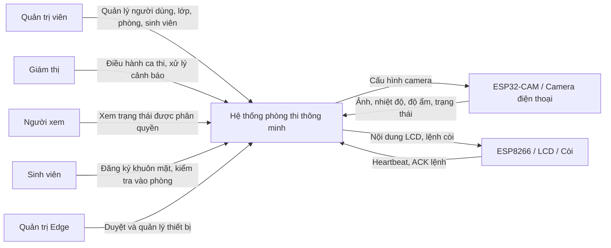

### Luồng dữ liệu tại biên hệ thống

- Người dùng truy cập Central Server bằng dashboard web.
- Quản trị Edge truy cập Edge Console trong mạng LAN.
- Thiết bị trao đổi dữ liệu với Edge qua HTTP và MQTT.
- Edge chủ động kết nối tới Central qua HTTP và WebSocket.
- Ảnh gốc không được gửi lên Central; chỉ embedding khuôn mặt và metadata được đồng bộ.

## 4. Sơ đồ use case

Mermaid không có ký pháp use case UML riêng, vì vậy sơ đồ dưới đây dùng một biên hệ thống và các quan hệ chức năng tương đương.

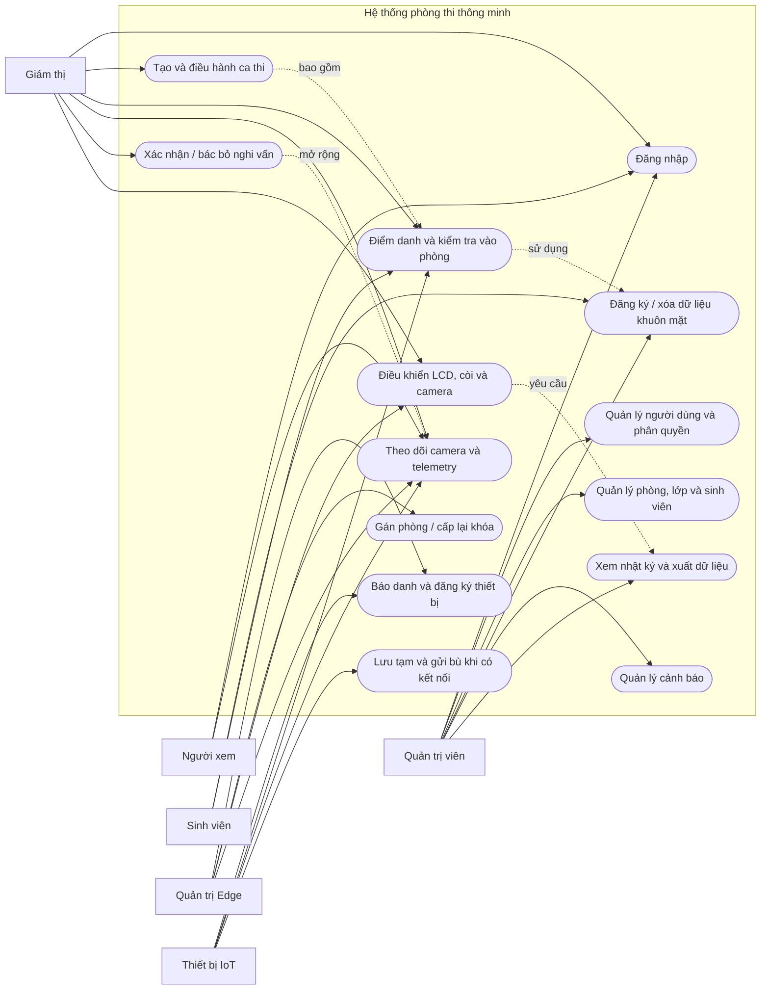

## 5. Sơ đồ kiến trúc tổng thể

Kiến trúc tách thành Central và Edge. Vòng điều khiển thời gian thực chạy tại Edge; Central giữ dữ liệu nghiệp vụ và cung cấp giao diện quản trị tập trung.

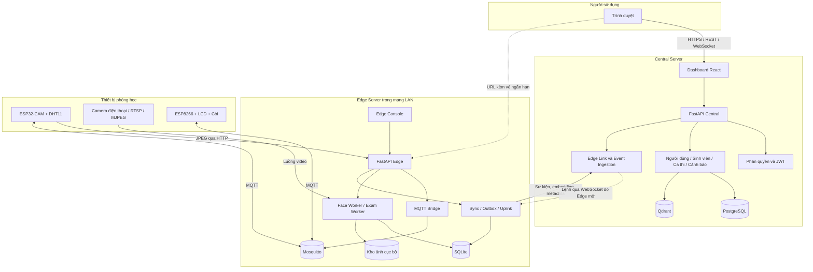

### Nguyên tắc kiến trúc

1. Edge chủ động kết nối lên Central nên Edge có thể nằm sau NAT.
2. AI và vòng điều khiển thiết bị chạy tại Edge để giảm độ trễ và vẫn hoạt động khi mất Internet.
3. Central không lưu ảnh; Central chỉ giữ tham chiếu ảnh, embedding và metadata.
4. Edge dùng outbox bền vững để gửi bù sự kiện sau khi kết nối được khôi phục.
5. Lệnh thiết bị có mã lệnh, ACK, thời hạn, thử lại và trạng thái kết quả.

## 6. Sơ đồ kiến trúc phân lớp

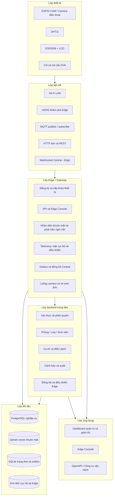

## 7. Trách nhiệm của từng lớp

### 7.1. Lớp thiết bị

- Thu nhận ảnh, nhiệt độ và độ ẩm.
- Hiển thị thông tin phòng và trạng thái trên LCD.
- Phát còi theo lệnh `once`, `continuous` hoặc `stop`.
- Lưu cấu hình Wi-Fi và thông tin được cấp sau khi đăng ký.
- Gửi heartbeat, trạng thái và ACK lệnh.

Mã nguồn liên quan: `firmware/node_a_cam/`, `firmware/node_b_lcd/`.

### 7.2. Lớp kết nối

- Wi-Fi cung cấp kết nối LAN cho thiết bị.
- mDNS giúp thiết bị tự tìm Edge Server.
- HTTP được dùng để báo danh, nhận cấu hình và gửi frame JPEG.
- MQTT được dùng cho telemetry, trạng thái, cấu hình và lệnh có ACK.
- WebSocket duy trì kênh điều khiển từ Central tới Edge.

Mã nguồn liên quan: `SmartProvision.h`, `mqtt_bridge.py`, `mdns.py`, `edge_link.py`.

### 7.3. Lớp Edge/Gateway

- Quản lý vòng đời và thông tin xác thực của thiết bị.
- Nhận ảnh, chạy AI và giữ ảnh tại mạng cục bộ.
- Điều khiển LCD/còi mà không phụ thuộc kết nối Central.
- Lưu sự kiện vào outbox và gửi bù với cơ chế loại trùng.
- Cấp luồng camera/ảnh theo token hoặc vé JWT có phạm vi hẹp.

Mã nguồn liên quan: `backend/edge/app/` và `frontend/edge-console/`.

### 7.4. Lớp backend

- Xác thực, phân quyền và quản lý phiên đăng nhập.
- Quản lý người dùng, phòng, lớp, sinh viên và sự đồng ý sử dụng khuôn mặt.
- Quản lý ca thi, kết quả điểm danh, nghi vấn và cảnh báo.
- Lưu lịch sử telemetry và nhật ký audit.
- Đồng bộ trạng thái mong muốn xuống Edge và tiếp nhận sự kiện từ Edge.

Mã nguồn liên quan: `backend/central/app/`.

### 7.5. Lớp dữ liệu

- PostgreSQL lưu dữ liệu nghiệp vụ dài hạn tại Central.
- Qdrant lưu embedding khuôn mặt phục vụ tìm kiếm vector.
- SQLite lưu thiết bị, ca đang hoạt động, lệnh và outbox tại Edge.
- Hệ thống tệp tại Edge lưu frame và ảnh khuôn mặt theo thời hạn lưu giữ.

Mã nguồn liên quan: `backend/*/app/models.py`, `database/`, `backend/edge/app/services/gallery.py`.

### 7.6. Lớp ứng dụng

- Dashboard React phục vụ quản trị viên, giám thị và người xem.
- Edge Console phục vụ cài đặt, duyệt, gán phòng và kiểm tra thiết bị tại LAN.
- API hỗ trợ tích hợp, kiểm thử và vận hành hệ thống.

Mã nguồn liên quan: `frontend/dashboard/`, `frontend/edge-console/`.

## 8. Ánh xạ yêu cầu với thành phần triển khai

| Yêu cầu | Thành phần chính |
|---|---|
| Thiết bị tự tìm và đăng ký Edge | `SmartProvision.h`, `device_api.py`, `enrollment_service.py` |
| Thu nhận telemetry | `mqtt_bridge.py`, `telemetry_service.py` |
| Điểm danh khuôn mặt | `face_worker.py`, `face_model.py`, `session_service.py` |
| Phát hiện nghi vấn trong ca thi | `exam_worker.py`, `edge_events.py` |
| Điều khiển LCD và còi | `command_service.py`, `node_b_lcd.ino` |
| Hoạt động khi mất Central | `uplink.py`, bảng outbox trong SQLite |
| Xem ảnh nhưng không đưa ảnh lên Central | `stream_service.py`, `gallery.py`, vé JWT |
| Quản lý tập trung | Central API và dashboard React |
| Lưu vector khuôn mặt | `face_store.py`, Qdrant |
| Audit và phân quyền | `security.py`, `audit.py`, các dependency phân quyền |

## 9. Ràng buộc và giả định thiết kế

- Thiết bị và Edge nằm trong cùng mạng LAN hoặc có định tuyến tới nhau.
- ESP8266/ESP32 sử dụng Wi-Fi 2.4 GHz.
- HTTP và MQTT trong LAN hiện không sử dụng TLS; môi trường triển khai phải cô lập mạng thiết bị.
- Liên kết Central–Edge nên được đặt sau HTTPS/WSS khi triển khai ngoài môi trường thử nghiệm.
- Trình duyệt cần truy cập được Edge qua LAN hoặc VPN để xem camera và ảnh bằng chứng.
- Worker AI phải chạy riêng bên cạnh Edge API.
- Ảnh tại Edge có thời hạn lưu mặc định 7 ngày; hỏng máy Edge có thể làm mất ảnh chưa sao lưu.
- Các khóa và mật khẩu mặc định phải được thay bằng giá trị trong `.env` trước khi triển khai.

## 10. Sơ đồ khối phần cứng

Hệ thống phần cứng gồm hai node độc lập dùng chung mạng Wi-Fi. Node camera thu nhận ảnh và dữ liệu môi trường; node chấp hành hiển thị trạng thái và phát cảnh báo.

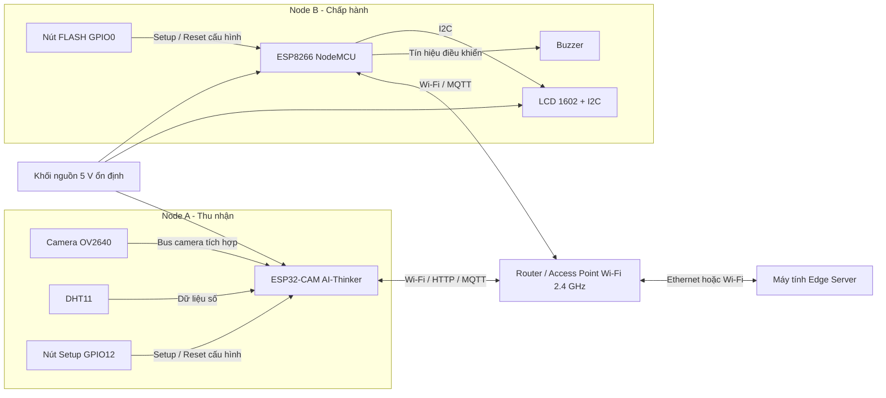

### Chức năng các khối

| Khối | Chức năng |
|---|---|
| ESP32-CAM | Chụp JPEG, đọc DHT11, gửi telemetry và frame tới Edge |
| OV2640 | Cảm biến hình ảnh dùng cho điểm danh và giám sát |
| DHT11 | Đo nhiệt độ và độ ẩm phòng |
| ESP8266 | Nhận nội dung hiển thị/lệnh còi, gửi heartbeat và ACK |
| LCD 1602 I2C | Hiển thị phòng, nhiệt độ, độ ẩm và khuyến nghị |
| Buzzer | Báo điểm danh thành công hoặc cảnh báo liên tục |
| Nút Setup | Xóa Wi-Fi hoặc factory reset tùy thời gian giữ nút |
| Edge Server | Broker MQTT, API nhận ảnh, xử lý AI và điều khiển cục bộ |

## 11. Sơ đồ kết nối cảm biến và cơ cấu chấp hành

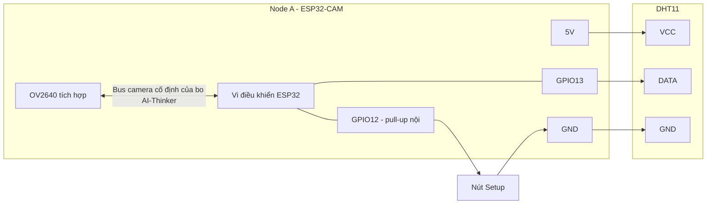

> Khối `OV2640` dùng các chân camera cố định của bo AI-Thinker. GPIO13 dành riêng cho DATA của DHT11 trong dự án này.

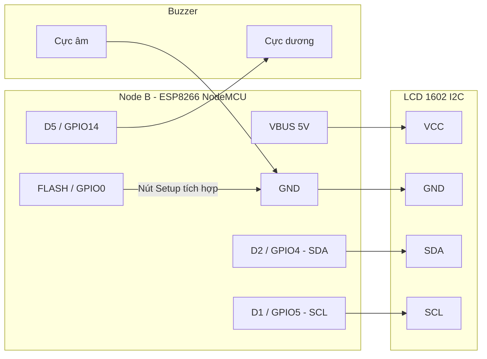

### Bảng nối dây

| Node | Thiết bị | Chân ngoại vi | Chân vi điều khiển |
|---|---|---|---|
| ESP32-CAM | DHT11 | DATA | GPIO13 |
| ESP32-CAM | DHT11 | VCC / GND | 5V / GND |
| ESP32-CAM | Nút Setup | Hai đầu nút | GPIO12 / GND |
| ESP8266 | LCD I2C | SDA | D2 / GPIO4 |
| ESP8266 | LCD I2C | SCL | D1 / GPIO5 |
| ESP8266 | LCD I2C | VCC / GND | VBUS 5V / GND |
| ESP8266 | Buzzer | Dương / Âm | D5 GPIO14 / GND |
| ESP8266 | Nút Setup | Nút FLASH tích hợp | GPIO0 |

Lưu ý an toàn và nạp chương trình:

- Không cấp 5 V vào chân tín hiệu 3.3 V.
- ESP32-CAM cần nguồn 5 V ổn định vì camera và Wi-Fi có dòng đỉnh tương đối cao.
- Khi nạp ESP32-CAM, nối IO0 xuống GND, reset và nạp; sau đó tháo IO0 khỏi GND và reset lại.
- GPIO12 của ESP32-CAM là chân strapping; không kéo lên 3.3 V bằng điện trở ngoài.
- Firmware mặc định điều khiển buzzer active-high. Nếu dùng buzzer passive phải bật cấu hình tương ứng trong firmware.

## 12. Sơ đồ triển khai

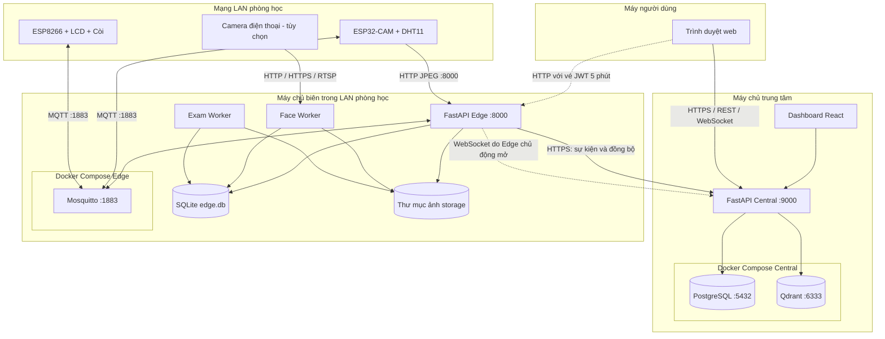

### Tiến trình và cổng triển khai

| Nơi chạy | Thành phần | Cổng / tài nguyên | Ghi chú |
|---|---|---|---|
| Central | FastAPI Central | TCP 9000 | REST, WebSocket, có thể phục vụ bản build dashboard |
| Central | Dashboard Vite | TCP 5173 | Chỉ dùng khi phát triển |
| Central | PostgreSQL | TCP 5432 | Dữ liệu nghiệp vụ dài hạn |
| Central | Qdrant | TCP 6333 | Vector khuôn mặt |
| Edge | FastAPI Edge | TCP 8000 | API thiết bị, Edge Console, frame và stream |
| Edge | Mosquitto | TCP 1883 | MQTT trong LAN |
| Edge | Face Worker | Tiến trình nền | Nhận diện khuôn mặt |
| Edge | Exam Worker | Tiến trình nền | Phát hiện nghi vấn trong ca thi |
| Edge | SQLite | Tệp `backend/edge/data/edge.db` | Trạng thái cục bộ và outbox |
| Edge | Kho ảnh | `backend/edge/storage/` | Ảnh không rời Edge |

Trong môi trường demo, Central và Edge có thể chạy trên cùng một máy. Trong triển khai thực tế, chúng là hai vai trò logic riêng; mỗi phòng hoặc cụm phòng có thể có một Edge Server.

## 13. Mô hình dữ liệu và ERD

### 13.1. ERD dữ liệu trung tâm

Sơ đồ tập trung vào các thực thể nghiệp vụ và quan hệ chính trong PostgreSQL. Qdrant lưu vector khuôn mặt theo `student_id`; ảnh thật không tồn tại tại Central.

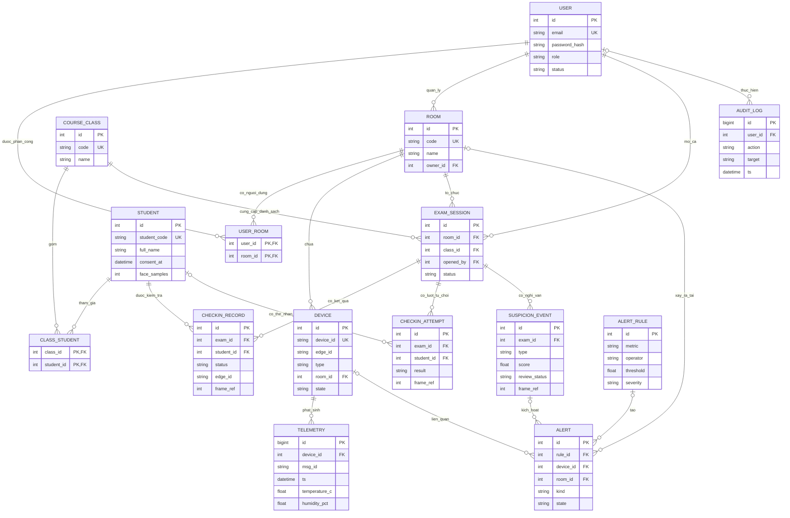

Các bảng kỹ thuật bổ sung tại Central gồm `revoked_tokens`, `edges` và `edge_events`. `edge_events` dùng khóa ghép `(edge_id, event_id)` để loại trùng khi Edge gửi lại sự kiện.

### 13.2. ERD dữ liệu Edge

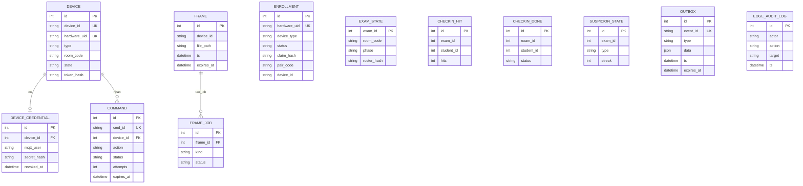

`ENROLLMENT`, `EXAM_STATE`, `CHECKIN_HIT`, `CHECKIN_DONE`, `SUSPICION_STATE`, `OUTBOX` và `EDGE_AUDIT_LOG` được tách độc lập hoặc liên kết logic bằng mã định danh; không phải mọi liên kết logic đều được khai báo bằng foreign key trong SQLite.

## 14. Mô tả API

### 14.1. Quy ước chung

| Thuộc tính | Central API | Edge API |
|---|---|---|
| Base URL mặc định | `http://localhost:9000/api/v1` | `http://localhost:8000` |
| Định dạng chính | JSON UTF-8 | JSON UTF-8; upload/response ảnh dùng JPEG |
| Tài liệu tương tác | `http://localhost:9000/docs` | `http://localhost:8000/docs` |
| Health check | `GET /api/health` | `GET /api/health` |
| Người dùng | `Authorization: Bearer <access_token>` | `Authorization: Bearer <console_token>` |
| Central xác thực Edge | `X-Edge-Id` và Bearer shared token | Không áp dụng |
| Thiết bị xác thực Edge | Không áp dụng | Bearer claim token hoặc device frame token |
| Worker nội bộ | Không áp dụng | `X-Service-Token` |

Các mã trạng thái chính: `200` thành công, `201` tạo mới, `202` đã nhận xử lý nền, `204` thành công không có body, `400/422` dữ liệu không hợp lệ, `401` chưa xác thực, `403` thiếu quyền, `404` không tồn tại và `409` xung đột trạng thái.

### 14.2. Central API

| Nhóm | Endpoint tiêu biểu | Mô tả |
|---|---|---|
| Xác thực | `POST /auth/login`, `POST /auth/refresh`, `POST /auth/logout` | Đăng nhập, làm mới và thu hồi refresh token |
| Hồ sơ | `GET /users/me`, `PATCH /users/me/password` | Đọc hồ sơ và đổi mật khẩu |
| Người dùng | `GET/POST /users`, `PATCH /users/{id}` | Quản lý tài khoản và phân quyền; yêu cầu admin |
| Phòng | `GET/POST /rooms` | Danh sách và tạo phòng |
| Lớp | `GET/POST /classes`, `GET /classes/{id}`, `PUT /classes/{id}/students` | Quản lý lớp và danh sách sinh viên |
| Sinh viên | `GET/POST /students`, `PATCH /students/{id}`, `PUT /students/{id}/classes` | Quản lý hồ sơ và lớp tham gia |
| Khuôn mặt | `/students/{id}/face-samples`, `/face-ticket`, `/face-refresh`, `/face-data` | Liệt kê, cấp vé đăng ký, làm mới hoặc xóa dữ liệu sinh trắc học |
| Thiết bị | `GET /devices`, `PUT /devices/{id}/config` | Xem thiết bị và đổi cấu hình từ xa |
| Lệnh | `POST/GET /devices/{id}/commands` | Gửi lệnh và xem trạng thái ACK |
| Camera | `GET /devices/{id}/stream-ticket` | Cấp URL có vé để xem luồng trực tiếp tại Edge |
| Telemetry | `GET /devices/{id}/telemetry` | Truy vấn raw hoặc tổng hợp `1m`, `5m`, `15m`, `1h` |
| Ca thi | `POST/GET /exam/sessions`, `GET /exam/sessions/{id}` | Mở, liệt kê và xem chi tiết ca |
| Vòng đời ca | `POST /exam/sessions/{id}/start`, `/close`, `/checkin` | Bắt đầu giám sát, đóng ca và quyết định điểm danh thủ công |
| Bằng chứng | `/exam/checkin/.../frame`, `/exam/events/{id}/frame` | Cấp vé xem ảnh tại Edge và ghi audit |
| Nghi vấn | `PATCH /exam/events/{id}` | Xác nhận hoặc bác bỏ nghi vấn |
| Cảnh báo | `GET /alerts`, `PATCH /alerts/{id}` | Tra cứu, xác nhận và xử lý cảnh báo |
| Quy tắc | `GET/POST /alert-rules`, `PUT /alert-rules/{id}` | Cấu hình điều kiện cảnh báo |
| Vận hành | `GET /audit-logs`, `GET /export/telemetry.csv` | Audit và xuất dữ liệu |
| Realtime | `WS /ws`, `WS /ws/exam/{id}` | Cập nhật dashboard và ca thi |
| Edge integration | `/edge/sync`, `/edge/events`, `/edge/faces`, `/edge/identify`, `WS /edge/link` | Đồng bộ Central–Edge |

### 14.3. Edge API

| Nhóm | Endpoint | Mô tả |
|---|---|---|
| Báo danh | `POST /api/v1/device-enrollments/announce` | Thiết bị gửi UID, loại, phiên bản và nhận claim token/mã ghép |
| Lấy cấu hình | `GET /api/v1/device-enrollments/{hardware_uid}` | Poll trạng thái; sau khi duyệt trả MQTT credential, topic và frame token |
| Gửi ảnh | `POST /api/v1/devices/{device_id}/frames` | Body là JPEG, xác thực bằng device frame token |
| Đăng nhập Edge | `POST /edge/v1/auth/login` | Nhận console token |
| Trạng thái | `GET /edge/v1/status`, `POST /edge/v1/sync/retry` | Xem broker, Central link, outbox, mDNS và yêu cầu đồng bộ lại |
| Nguồn camera | CRUD `/edge/v1/camera-sources` | Quản lý nguồn HTTP, HTTPS, RTSP hoặc MJPEG |
| Enrollment | `/edge/v1/enrollments` | Duyệt, từ chối, xóa hoặc chấp nhận ghép lại thiết bị |
| Thiết bị | `/edge/v1/devices` | Liệt kê, gán phòng, cấp lại khóa, chuyển trạng thái và xóa |
| Điều khiển | `/edge/v1/devices/{id}/config`, `/commands` | Cấu hình và gửi lệnh thử tại Edge |
| Ảnh/stream | `/edge/v1/devices/{id}/stream`, `/edge/v1/frames/{id}` | MJPEG và ảnh bằng chứng theo token/vé |
| Đăng ký mặt | `/edge/v1/faces/{student_id}/samples` | Nhận ảnh, cắt mặt, lưu ảnh tại Edge và gửi vector lên Central |
| Worker nội bộ | `POST /internal/checkin-admitted`, `POST /internal/emit` | Worker báo kết quả AI cho Edge API |

### 14.4. Ví dụ gọi API

Đăng nhập Central:

```http
POST /api/v1/auth/login HTTP/1.1
Content-Type: application/json

{
  "email": "admin@classroom.local",
  "password": "<mat-khau>"
}
```

Gửi lệnh còi:

```http
POST /api/v1/devices/lcd-01/commands HTTP/1.1
Authorization: Bearer <access_token>
Content-Type: application/json

{
  "action": "buzzer",
  "pattern": "once"
}
```

Thiết bị báo danh với Edge:

```http
POST /api/v1/device-enrollments/announce HTTP/1.1
Content-Type: application/json

{
  "hardware_uid": "30:76:F5:EF:DE:5C",
  "factory_name": "ESP32-CAM",
  "device_type": "esp32_cam",
  "firmware_version": "2.0.0"
}
```

## 15. Cấu trúc topic và payload MQTT

### 15.1. Quy tắc đặt topic

```text
classroom/{room_code}/{device_id}/{message_type}
```

Ví dụ:

```text
classroom/A101/cam-01/telemetry
classroom/A101/cam-01/config
classroom/A101/lcd-01/cmd
classroom/A101/lcd-01/cmd/ack
```

`room_code` và `device_id` do Edge cấp sau khi quản trị viên duyệt và gán phòng. Thiết bị không ghi cứng topic trong firmware. ACL của Mosquitto giới hạn mỗi thiết bị vào đúng nhánh topic được cấp.

### 15.2. Danh sách topic

| Hậu tố | Chiều | QoS | Retain | Thiết bị | Mục đích |
|---|---|---:|---:|---|---|
| `telemetry` | Thiết bị → Edge | 1 | Không | Camera | Nhiệt độ, độ ẩm |
| `heartbeat` | Thiết bị → Edge | 0 | Không | Cả hai | Trạng thái sống, RSSI, uptime |
| `status` | Thiết bị → Edge | 1 | Có | Cả hai | Online/offline; dùng Last Will |
| `event` | Thiết bị → Edge | 1 | Không | Cả hai | Lỗi/phục hồi cảm biến, kết nối |
| `cmd` | Edge → Thiết bị | 1 | Không | Actuator | Lệnh còi hoặc LCD |
| `cmd/ack` | Thiết bị → Edge | 1 | Không | Actuator | Xác nhận kết quả lệnh |
| `config` | Edge → Thiết bị | 1 | Có | Cả hai | Chu kỳ gửi và chế độ camera |
| `display` | Edge → Thiết bị | 0 | Có | Actuator | Dữ liệu môi trường và khuyến nghị |

Edge subscribe wildcard:

```text
classroom/+/+/telemetry
classroom/+/+/heartbeat
classroom/+/+/status
classroom/+/+/event
classroom/+/+/cmd/ack
```

Broker còn sử dụng topic quản trị `$CONTROL/dynamic-security/v1` để Edge tạo/xóa tài khoản và ACL. Thiết bị không được phép truy cập topic quản trị này.

### 15.3. Payload mẫu

Telemetry từ ESP32-CAM:

```json
{
  "msg_id": "a1f3-000002",
  "device_id": "cam-01",
  "ts": "2026-11-18T08:30:00Z",
  "temperature_c": 28.4,
  "humidity_pct": 67.0,
  "fw": "2.0.0"
}
```

Heartbeat:

```json
{
  "device_id": "cam-01",
  "ts": "2026-11-18T08:30:15Z",
  "rssi": -58,
  "uptime_s": 3600,
  "heap": 182400,
  "fw": "2.0.0"
}
```

Status online và Last Will:

```json
{
  "state": "online",
  "fw": "2.0.0",
  "hw": "ESP32-CAM AI-Thinker + OV2640 + DHT11",
  "ts": "2026-11-18T08:30:00Z"
}
```

```json
{
  "state": "offline"
}
```

Cấu hình camera:

```json
{
  "telemetry_interval_s": 30,
  "heartbeat_interval_s": 15,
  "camera_mode": "checkin",
  "frame_interval_s": 0.2
}
```

Giá trị `camera_mode`: `idle`, `preview`, `checkin` hoặc `exam`.

Dữ liệu hiển thị LCD:

```json
{
  "room": "A101",
  "temp_c": 28.4,
  "hum_pct": 67,
  "status": "ok",
  "advice": "Dieu kien tot"
}
```

Lệnh còi và lệnh hiển thị:

```json
{
  "cmd_id": "c-a12b34cd",
  "action": "buzzer",
  "pattern": "once",
  "expires_at": "2026-11-18T08:31:00Z"
}
```

```json
{
  "cmd_id": "c-e56f78ab",
  "action": "display",
  "text": "Moi sinh vien vao phong",
  "expires_at": "2026-11-18T08:31:00Z"
}
```

ACK lệnh:

```json
{
  "cmd_id": "c-a12b34cd",
  "result": "ok",
  "ts": "2026-11-18T08:30:02Z"
}
```

`result` có thể là `ok`, `expired`, `duplicate` hoặc `error:<nguyên_nhân>`. Thiết bị lưu các `cmd_id` gần nhất để lệnh QoS 1 bị gửi lại không được thực thi hai lần. Edge thử gửi lại lệnh khi chưa có ACK và chuyển sang `timeout` khi hết số lần thử.

## 16. Sequence diagram các quy trình chính

### 16.1. Quy trình đăng ký và cấp quyền cho thiết bị

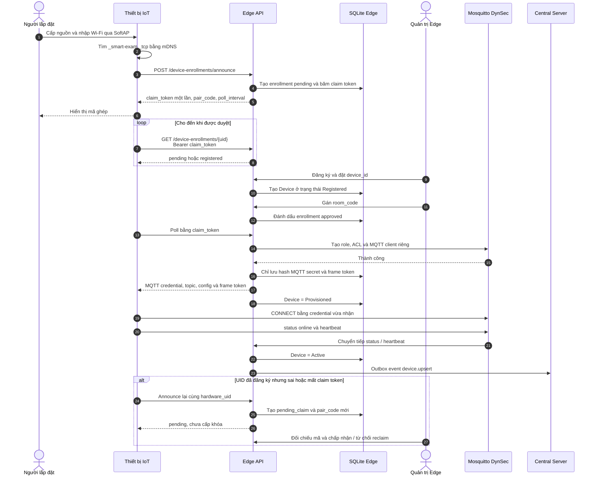

Điểm kiểm soát chính:

- Claim token chỉ trả rõ một lần và Edge chỉ lưu bản băm.
- MQTT credential chỉ được sinh khi chính thiết bị poll bằng claim token hợp lệ.
- Người quản trị không nhìn thấy hoặc sao chép khóa thiết bị.
- Thiết bị báo danh lại không có token chỉ tạo yêu cầu reclaim; khóa cũ không bị chiếm.
- ACL giới hạn thiết bị trong nhánh `classroom/{room}/{device}/...` được cấp.

### 16.2. Quy trình điểm danh bằng khuôn mặt

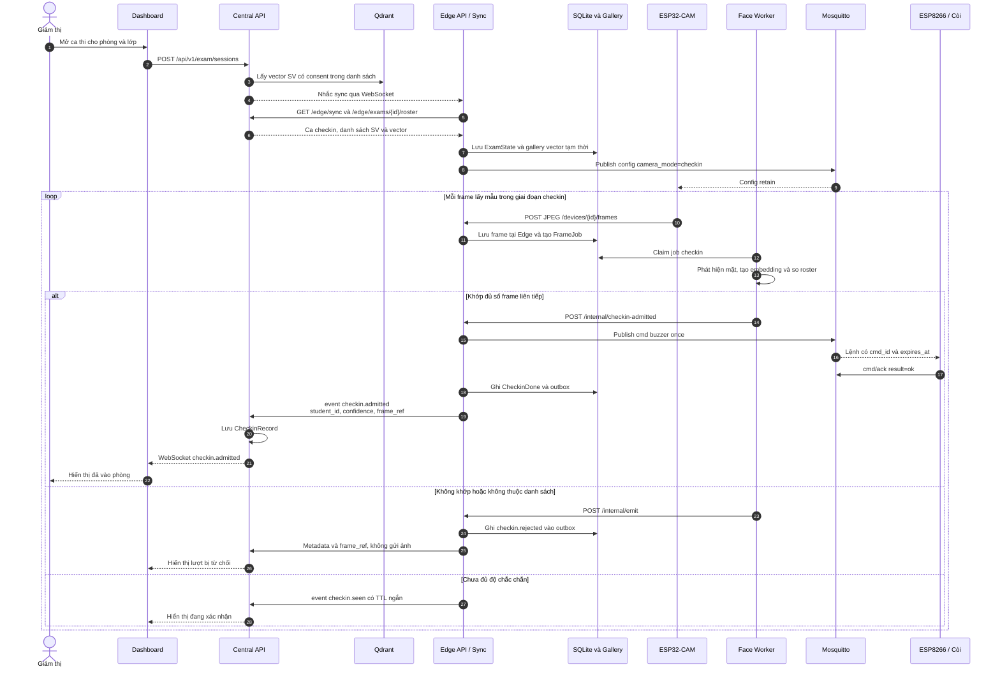

Ảnh gốc và ảnh cắt khuôn mặt chỉ nằm ở Edge. Central nhận `student_id`, độ tin cậy, `edge_id` và `frame_ref`; dashboard muốn xem ảnh phải xin vé có scope cho đúng frame.

### 16.3. Quy trình phát hiện và xử lý nghi vấn gian lận

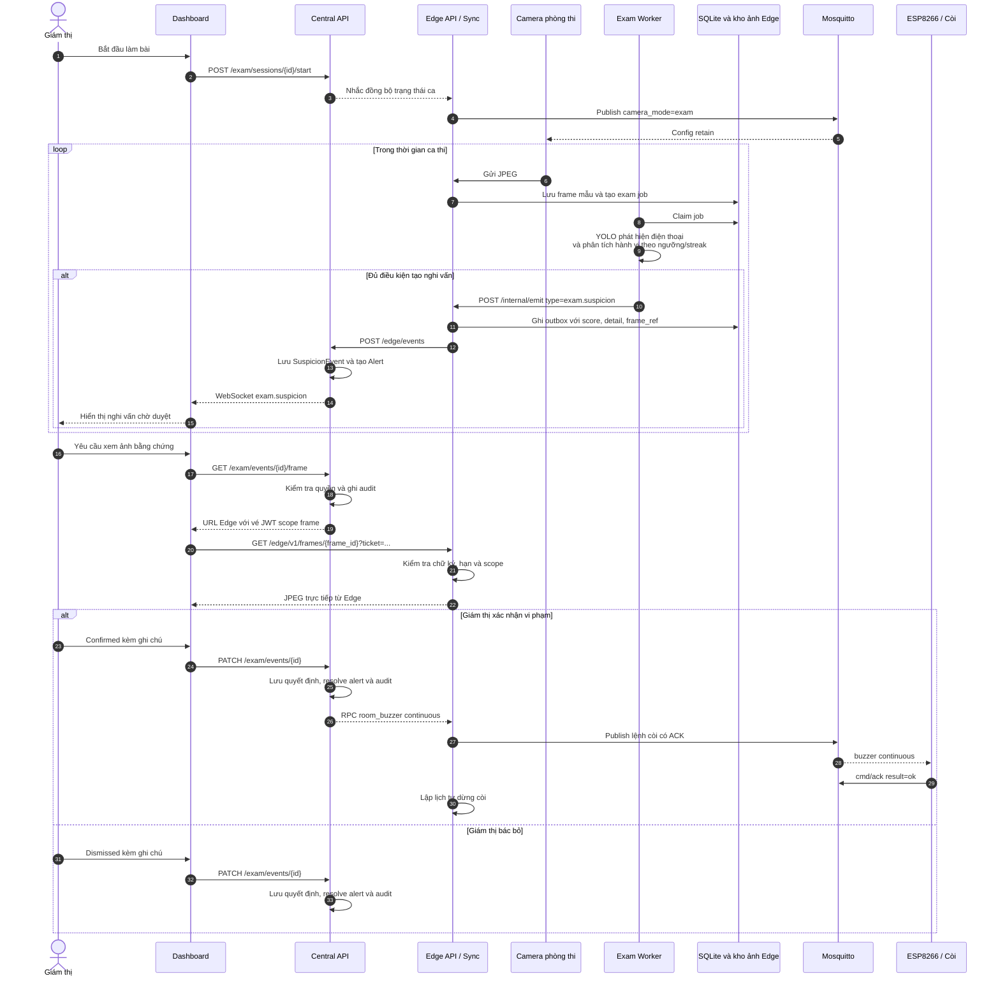

AI chỉ tạo nghi vấn; quyết định cuối cùng thuộc về giám thị. Đây là cơ chế human-in-the-loop nhằm giảm tác động của nhận diện sai.

## 17. Mô hình trạng thái vòng đời thiết bị

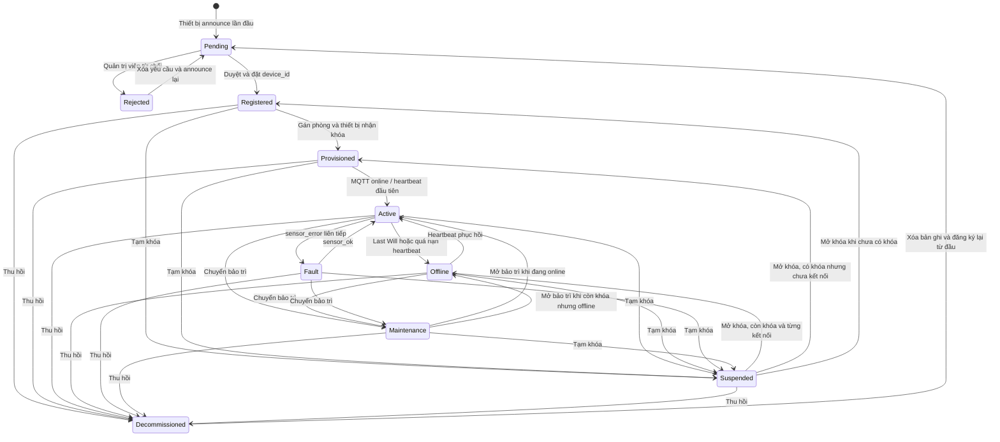

### Ý nghĩa trạng thái

| Trạng thái | Ý nghĩa |
|---|---|
| `Pending` | Yêu cầu báo danh đang chờ quản trị viên Edge xử lý |
| `Rejected` | Yêu cầu bị từ chối hoặc thiết bị đã bị thu hồi |
| `Registered` | Đã có `device_id` nhưng chưa có credential hợp lệ |
| `Provisioned` | Đã nhận credential nhưng chưa kết nối MQTT |
| `Active` | Đang hoạt động và có heartbeat |
| `Offline` | Mất kết nối hoặc quá thời gian heartbeat |
| `Fault` | Thiết bị còn kết nối nhưng cảm biến lỗi liên tục |
| `Maintenance` | Được đưa vào chế độ bảo trì thủ công |
| `Suspended` | Bị tạm khóa; Mosquitto vô hiệu hóa tài khoản và ngắt phiên |
| `Decommissioned` | Đã thu hồi credential; không được hoạt động lại nếu chưa xóa bản ghi |

Khi đổi phòng hoặc cấp lại khóa, Edge thu hồi tài khoản/ACL và token cũ, dọn retained topic cũ rồi đưa thiết bị về `Registered`. Thiết bị dùng claim token để tự nhận credential và topic mới.

## 18. Ma trận vai trò và quyền

### 18.1. Vai trò Central

Ký hiệu: **✓** được phép, **Xem** chỉ đọc, **—** không được phép. Quyền `Admin` bao hàm quyền `Operator` và `Viewer`; quyền `Operator` bao hàm các API đọc chung.

| Chức năng | Admin | Operator / Giám thị | Viewer |
|---|:---:|:---:|:---:|
| Đăng nhập, xem hồ sơ, đổi mật khẩu của mình | ✓ | ✓ | ✓ |
| Xem phòng, lớp, thiết bị, telemetry và cảnh báo | Xem | Xem | Xem |
| Xem danh sách ca và chi tiết ca được phân phòng | Xem | Xem | Xem |
| Xem luồng camera bằng stream ticket | Xem | Xem | Xem |
| Quản lý người dùng, vai trò và phòng được phân | ✓ | — | — |
| Tạo phòng | ✓ | — | — |
| Tạo/sửa lớp và danh sách lớp | ✓ | ✓ | — |
| Tạo/sửa sinh viên và quan hệ lớp | ✓ | ✓ | — |
| Đăng ký, làm mới hoặc xóa dữ liệu khuôn mặt | ✓ | ✓ | — |
| Tạo ca, bắt đầu/đóng ca và điểm danh thủ công | ✓ | ✓ | — |
| Xem ảnh điểm danh hoặc ảnh bằng chứng | ✓ | ✓ | — |
| Xác nhận/bác bỏ nghi vấn gian lận | ✓ | ✓ | — |
| Gửi lệnh còi/LCD và đổi cấu hình thiết bị | ✓ | ✓ | — |
| Xác nhận hoặc xử lý cảnh báo | ✓ | ✓ | — |
| Tạo/sửa quy tắc cảnh báo | ✓ | — | — |
| Xem audit log toàn hệ thống | ✓ | — | — |
| Xuất telemetry CSV | ✓ | ✓ | — |

Phạm vi phòng vẫn được kiểm tra ngoài vai trò: người dùng không phải admin chỉ thao tác/xem dữ liệu thuộc các phòng được gán. `Viewer` có thể xin stream ticket theo router hiện tại nhưng không được xin ảnh bằng chứng ca thi hay thực hiện thao tác điều khiển.

### 18.2. Vai trò ngoài Central

| Chủ thể | Quyền | Cơ chế xác thực |
|---|---|---|
| Quản trị Edge | Duyệt/reclaim thiết bị, gán phòng, cấp lại khóa, chuyển trạng thái, cấu hình, gửi lệnh thử, quản lý nguồn camera và xem audit Edge | Console JWT nhận từ mật khẩu `EDGE_ADMIN_PASSWORD` |
| Edge Server | Đồng bộ trạng thái, đẩy sự kiện, gửi vector, định danh vector và mở WebSocket điều khiển | `X-Edge-Id` + Bearer shared token |
| Worker AI | Báo điểm danh thành công và phát sự kiện AI cho Edge API | `X-Service-Token` |
| Camera | Publish telemetry/status/event, nhận config và upload JPEG | MQTT credential/ACL riêng + frame token |
| Node chấp hành | Nhận cmd/display/config; publish status/event/heartbeat/ACK | MQTT credential và ACL riêng |
| Sinh viên | Là đối tượng nghiệp vụ của điểm danh và consent; hiện không có tài khoản đăng nhập riêng | Không có API đăng nhập sinh viên trong phiên bản hiện tại |

## 19. Mô hình mối đe dọa và biện pháp kiểm soát

### 19.1. Tài sản và ranh giới tin cậy

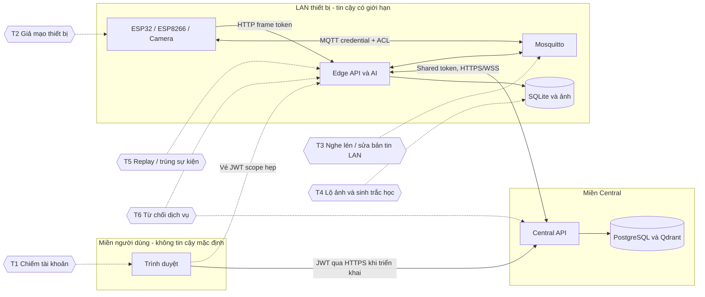

Tài sản cần bảo vệ gồm mật khẩu và token; credential MQTT; ảnh khuôn mặt/ảnh bằng chứng; vector sinh trắc học; dữ liệu sinh viên và ca thi; quyết định của giám thị; lệnh còi/LCD; audit log; tính sẵn sàng của Edge trong thời gian thi.

### 19.2. Phân tích theo STRIDE

| ID | Nhóm | Mối đe dọa / đường tấn công | Kiểm soát hiện có | Rủi ro còn lại và khuyến nghị |
|---|---|---|---|---|
| S1 | Spoofing | Đăng nhập bằng tài khoản người dùng bị đánh cắp | Mật khẩu băm bcrypt; access/refresh JWT có hạn; refresh token có thể thu hồi; tài khoản có trạng thái locked | Chưa có MFA và rate limit đăng nhập. Nên thêm MFA cho admin, throttling, khóa tạm và cảnh báo đăng nhập bất thường |
| S2 | Spoofing | Giả MAC/hardware UID để lấy credential thiết bị | Claim token; chỉ lưu hash; mã ghép; thiết bị đã đăng ký nhưng thiếu token phải qua reclaim thủ công | Claim token đi qua HTTP trong LAN. Nên dùng mạng IoT cô lập, HTTPS cục bộ nếu phần cứng đáp ứng hoặc cơ chế challenge ký |
| S3 | Spoofing | Giả Edge Server gọi Central | `X-Edge-Id` + Bearer token riêng từng Edge; so sánh secret an toàn | Shared secret cấu hình thủ công, chưa có mTLS. Nên cấp chứng thư riêng từng Edge và luân chuyển khóa định kỳ |
| T1 | Tampering | Sửa telemetry, lệnh hoặc frame khi truyền trong LAN | MQTT username/password và ACL theo topic; frame token; kiểm tra schema/miền giá trị; lệnh có ACK | HTTP/MQTT LAN chưa mã hóa nên bên có quyền truy cập mạng vẫn có thể nghe lén/sửa lưu lượng. Nên tách VLAN, bật TLS hoặc đặt gateway bảo vệ |
| T2 | Tampering | Sửa trạng thái ca thi hoặc quyết định nghi vấn qua API | JWT, RBAC, kiểm tra phạm vi phòng, validation Pydantic và audit | Cần bảo vệ JWT secret, dùng HTTPS, CSP/CSRF phù hợp cách lưu token và kiểm thử phân quyền định kỳ |
| R1 | Repudiation | Người vận hành phủ nhận đã xem ảnh, gửi lệnh hoặc đưa ra quyết định | Audit log ở Central/Edge ghi actor, action, target, IP, thời gian; quyết định lưu `reviewed_by` | Audit hiện nằm cùng CSDL và chưa bất biến. Nên sao lưu sang log append-only/WORM và đồng bộ thời gian tin cậy |
| I1 | Information disclosure | Rò rỉ ảnh khuôn mặt hoặc ảnh bằng chứng | Ảnh chỉ lưu Edge; Central giữ `frame_ref`; vé JWT 5 phút có scope chính xác; xem ảnh được audit; tự xóa theo retention | Ảnh trên đĩa Edge chưa nêu mã hóa at-rest. Nên mã hóa ổ đĩa, giới hạn quyền thư mục và có quy trình xóa an toàn |
| I2 | Information disclosure | Rò rỉ vector khuôn mặt hoặc dữ liệu sinh viên | Consent trước khi nhận vector; RBAC; Qdrant không công khai qua ứng dụng; có API xóa dữ liệu khuôn mặt | Vector vẫn là dữ liệu sinh trắc học nhạy cảm. Nên hạn chế cổng Qdrant, mã hóa backup và quy định thời hạn lưu |
| I3 | Information disclosure | Lộ secret qua mã nguồn/cấu hình/log | `.env.example` chỉ có placeholder; secret thật nằm trong `.env`; DB chỉ lưu hash credential thiết bị | Giá trị mặc định yếu vẫn tồn tại trong config. Triển khai phải bắt buộc đổi secret, quét secret trong CI và hạn chế quyền đọc `.env` |
| D1 | Denial of service | Flood yêu cầu enrollment, frame hoặc API | Giới hạn 50 enrollment pending; frame tối đa 100 KiB; sampling frame AI; queue có giới hạn; timeout/backoff | Chưa có rate limiter/reverse proxy. Nên áp giới hạn theo IP/device, giới hạn kết nối broker và giám sát tài nguyên |
| D2 | Denial of service | Central hoặc Internet mất kết nối trong ca thi | Edge xử lý AI/điều khiển cục bộ; outbox SQLite; retry backoff; Central loại trùng khi gửi bù | Hỏng vật lý Edge vẫn làm gián đoạn. Nên dùng UPS, health monitoring, backup cấu hình và phương án điểm danh thủ công |
| E1 | Elevation of privilege | Viewer gọi API điều khiển hoặc xem bằng chứng | Dependency `any_user`, `operator_up`, `admin_only`; kiểm tra room scope; test xác nhận Viewer bị 403 khi điều khiển/xem bằng chứng | Cần duy trì test authorization cho từng endpoint mới và tránh chỉ ẩn nút ở frontend |
| E2 | Elevation of privilege | Chiếm worker/service token hoặc Edge console token | Header/service token riêng; console JWT có hạn; API nội bộ tách prefix | Service token là secret tĩnh và endpoint vẫn nghe trên interface Edge. Nên bind nội bộ khi có thể, luân chuyển token và tách network policy |
| RP1 | Replay | Gửi lại lệnh MQTT cũ hoặc ACK giả | `cmd_id`, `expires_at`, cache chống trùng trên thiết bị, ACK và retry có giới hạn | Cache chống trùng trên thiết bị chỉ giữ số lượng gần nhất. TLS và chữ ký/HMAC từng lệnh sẽ giảm replay sau reboot |
| RP2 | Replay | Gửi trùng telemetry hoặc sự kiện Edge sau lỗi mạng | Unique `(device_id, msg_id)` cho telemetry; unique `(edge_id, event_id)` cho Edge event; chỉ xóa outbox sau ACK/commit | Cần giám sát backlog, dung lượng SQLite và đồng hồ thiết bị để phát hiện sự kiện quá cũ |
| P1 | Physical | Kẻ tấn công reset/đọc flash hoặc thay thiết bị tại phòng | Factory reset dẫn tới reclaim; mã ghép phải được admin đối chiếu; rekey/thu hồi vô hiệu hóa credential cũ | MCU không có secure element; người có quyền vật lý có thể trích secret. Nên niêm phong thiết bị, khóa tủ, secure boot/flash encryption nếu board hỗ trợ |

### 19.3. Ưu tiên xử lý trước triển khai thật

1. Thay toàn bộ secret mặc định và bật HTTPS/WSS cho Central–Edge.
2. Cô lập thiết bị trong VLAN IoT; chỉ cho phép tới Edge trên các cổng cần thiết.
3. Thêm rate limit cho đăng nhập, enrollment, upload frame và giới hạn kết nối MQTT.
4. Mã hóa ổ đĩa Edge, PostgreSQL/Qdrant backup và kiểm soát quyền thư mục ảnh.
5. Thêm MFA cho admin, luân chuyển Edge/service token và cân nhắc mTLS.
6. Đẩy audit/security log sang nơi lưu append-only và thiết lập cảnh báo vận hành.
7. Duy trì kiểm thử phân quyền, replay, mất mạng và khôi phục trước mỗi lần phát hành.

